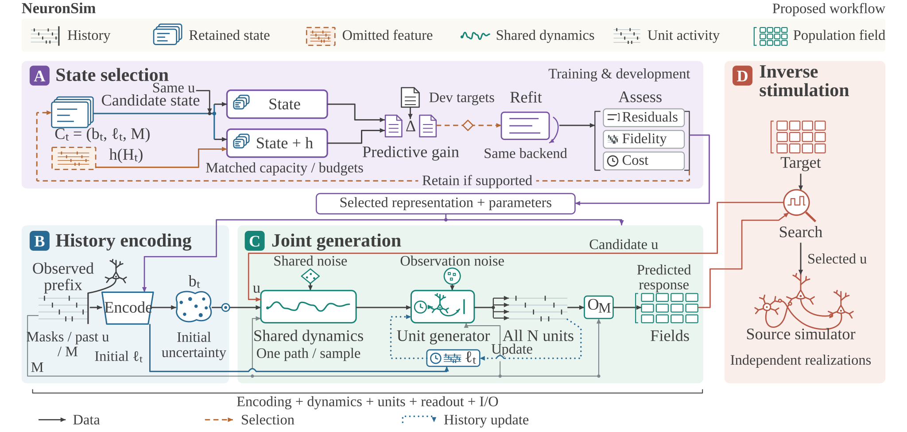
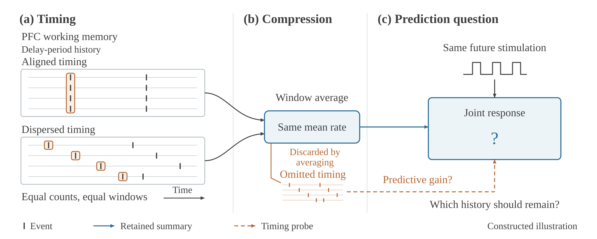

# NeuronSim: Predictive History Selection for Simulating Large Neural Populations and Designing Stimuli

**Anonymous Open-Source Release for ACM TheWebConf 2027 (WWW '27) Double-Blind Review**



*Figure 1: Overview of the NeuronSim framework. **(A) State selection:** capacity- and budget-matched predictors compare a candidate effective state $C_t = (b_t, \ell_t, M)$ against the same state augmented by an omitted history feature $h(H_t)$ under identical stimulation $u$; supported predictive gains nominate state additions that are retained only if generator refitting improves residual closure, joint fidelity, and complete cost. **(B) History encoding:** observed causal prefixes, masks, delivered controls, and circuit metadata $M$ initialize the latent belief $b_t$ and per-unit local firing history $\ell_t$. **(C) Joint generation:** one shared stochastic latent path per sample drives all $N$ units through refractory, history-dependent emissions, and an explicit observation map $\mathcal{O}_M$ projects generated unit activity onto population fields. **(D) Inverse stimulation:** candidate stimuli are searched under the learned generator and verified on independent realizations of the mechanistic source simulator.*

---

**NeuronSim** is a controlled stochastic simulation and state-selection framework that addresses a fundamental question in both large-scale neural circuit modeling and multi-agent Web systems: *which aspects of observable interaction history must a compact predictive state retain to preserve joint future responses under admissible interventions and controls?*

In mechanistic neuroscience, simulating coupled spiking networks of $N \ge 100{,}000$ identified neurons (and coupled $1{,}000{,}000$-neuron extensions) requires advancing every neuron and delivering every synaptic event, making multi-trial sweeps and inverse stimulus design computationally expensive. Mean-rate reductions discard spike timing, refractory constraints, and shared fluctuations that shape joint population responses. In agentic Web systems on the **AppWorld** benchmark, collaborating tool-using agents face an analogous closure problem: deciding which interaction history (delivered peer messages, past tool observations, and visible task state) must be retained to allocate a bounded verification budget before executing state-changing Web API actions.

NeuronSim unifies both settings through **predictive history selection**: comparing capacity-, stimulus-, and budget-matched predictors to test whether omitted history features improve proper predictive scores for future joint outcomes, and retaining candidate state additions only when generator refitting improves the fidelity–complete cost frontier.

---

## Table of Contents

- [Methodological Overview](#methodological-overview)
- [Repository Architecture](#repository-architecture)
- [Package Responsibilities](#package-responsibilities)
- [Environment and Installation](#environment-and-installation)
- [Command-Line Entry Points and Workflows](#command-line-entry-points-and-workflows)
- [Experimental Protocol and Reproducibility Contract](#experimental-protocol-and-reproducibility-contract)
- [Double-Blind Review and Licensing](#double-blind-review-and-licensing)

---

## Methodological Overview



*Figure 2: Motivating question in prefrontal cortex (PFC) working memory. **(a) Timing:** two delay-period spike histories have equal event counts in equal observation windows but distinct spike timing across units (aligned versus dispersed). **(b) Compression:** window averaging maps both histories to the same mean firing rate while discarding fine timing. **(c) Prediction question:** under the same future stimulation, predictive history selection tests whether the omitted timing improves prediction of the future joint response beyond the retained state.*

### 1. Observation Maps and Approximate Closure

Consider a coupled system of $N$ identified units with metadata $M$ specifying population memberships, spatial or functional coordinates, and readout conventions. Let $Y_t = (Y_{1,t}, \dots, Y_{N,t})$ denote unit spike counts in the half-open native bin $[(t-1)\Delta, t\Delta)$. Population fields are defined through an explicit, shared observation map:

$$R_t = \mathcal{O}_M(Y_t),$$

ensuring that mechanistic reference trajectories and generated rollouts share identical physical units, spatial or population indices (e.g., V1 cortical coordinates, PFC tuning preferences, CA3 assembly memberships), and temporal resolution.

Given observable causal history $H_t$ at forecast origin $t\Delta$ and an admissible future control schedule $u = (u_t, \dots, u_{t+T-1}) \in \mathcal{U}_{\mathrm{eval}}$, a reduced simulator encodes $H_t$ into a latent belief distribution $b_t = q_\phi(z_t \mid H_t, M)$ while maintaining explicit per-unit local firing history $\ell_t$, forming the effective predictive state:

$$C_t = (b_t, \ell_t, M).$$

The pair $(C_t, Q_\theta)$ satisfies $\varepsilon$-approximate closure over horizon $T$ if the discrepancy between the controlled source law $P^u(Y_{t+1:t+T} \mid H_t, M)$ and the generated law $Q_\theta^u(Y_{t+1:t+T} \mid C_t)$ remains within tolerance $\varepsilon$ across all $u \in \mathcal{U}_{\mathrm{eval}}$.

### 2. Predictive History Selection

To separate omitted historical information from predictor capacity or optimization artifacts, NeuronSim evaluates paired predictors that differ only in a single candidate omitted history feature while matching architecture capacity, control inputs, and training budgets on development blocks:

1. **Information Decomposition:** Under log loss, the ideal predictive gain from augmenting the state with omitted history equals the conditional mutual information between the candidate feature and future joint responses given the baseline state and future controls; the empirical fitted gain decomposes into this conditional mutual information plus the predictor approximation-error difference.
2. **Generator Refitting and Cost Gate:** Candidate history features that yield positive, capacity-controlled predictive gains nominate state additions. The stochastic generator is refit with the augmented state and retains the addition only if joint trajectory fidelity and end-to-end computational cost improve on validation circuits.

### 3. Shared Stochastic Dynamics and Refractory Unit Generation

For a rollout $k = 0, \dots, T-1$ from a causal prefix, NeuronSim factorizes joint trajectory generation via a shared stochastic latent path $z_{0:T}$ driving all $N$ identified units:

$$z_0 \sim b_t, \qquad z_{k+1} \sim p_\theta(z_{k+1} \mid z_k, u_k, M), \qquad Y_{i,k+1} \sim p_\theta(Y_{i,k+1} \mid z_{k+1}, \ell_{i,k}, M_i), \qquad \ell_{i,k+1} = \mathcal{T}_i(\ell_{i,k}, Y_{i,k+1}).$$

- **Path-Mediated Cross-Unit Covariance:** By the law of total covariance, conditioning all units on a shared stochastic trajectory $Z = z_{1:T}$ induces cross-unit covariance $\operatorname{Cov}(\mathbb{E}[A_i \mid Z, \mathcal{B}], \mathbb{E}[A_j \mid Z, \mathcal{B}] \mid \mathcal{B})$ without requiring $O(N^2)$ explicit pairwise interactions.
- **Refractory Support Enforcement:** Unit emissions follow a native-clock renewal conditional intensity with deterministic dead time $\rho_i$ and elapsed time since last spike $a_i(s)$:
  $$\lambda_i(s) = \mathbf{1}\{a_i(s) \ge \rho_i\}\, f_\theta(z(s), \ell_i(s), M_i), \qquad f_\theta \ge 0,$$
  guaranteeing zero interspike-interval support violations relative to the source simulator's clock and threshold convention.

### 4. Complete-Cost Accounting and Source-Verified Inverse Stimulation

Generating $S$ joint trajectories of $T$ bins for $N$ units requires $\Omega(STN)$ output work regardless of latent dimension $K$. NeuronSim instruments disjoint wall-clock timings and peak host/device memory across prefix encoding, local-history initialization, latent rollout, full-unit emission, observation readout, and serialization. For inverse stimulus design, NeuronSim searches over admissible control schedules $u \in \mathcal{U}$ using the learned generator and verifies every selected stimulus directly inside the original mechanistic simulator on independent realizations.

### 5. Collaborative Web Agent Verification on AppWorld

On the multi-app **AppWorld** benchmark, NeuronSim applies the same approximate-closure and history-selection test to two collaborating agents (`planner` and `executor`) interacting with nine Web applications via REST-style tool APIs. At each decision point, the observable history comprises delivered inter-agent messages, prior tool execution observations, and visible task state. Predictive history selection identifies the compact interaction state needed to predict execution outcomes across candidate splits of a fixed verification budget $\mathcal{U}_{\mathrm{verify}}$ before committing state-changing actions.

---

## Repository Architecture

```text
NeuronSim/
├── Libs/
│   ├── population_dynamics/     # Core NeuronSim framework, circuit adapters, baselines, and AppWorld extension
│   │   ├── cuda/                # CUDA kernels and native RNG/connectivity patches
│   │   ├── fixtures/            # Frozen spatial and structural verification fixtures
│   │   └── requirements-*.txt   # Modular environment lock manifests per simulator/baseline backend
│   ├── configs/                 # Canonical YAML specifications for circuits, models, ablations, and AppWorld
│   ├── figures/                 # Manuscript vector illustrations and figure/table layout generators
│   ├── scripts/                 # Standalone experiment runners, Slurm/cluster wrappers, and replay tools
│   └── external/                # Pinned upstream reference implementations and baseline model adapters
├── README.md                    # Repository documentation and reproduction guide
└── .gitignore                   # Workspace exclusion rules for raw data, checkpoints, and local logs
```

| Directory | Responsibility |
| --- | --- |
| [Libs/population_dynamics/](Libs/population_dynamics/) | Primary Python package implementing data intake, mechanistic circuit adapters (V1, PFC, CA3, Mesocircuit), shared stochastic latent dynamics, native-clock renewal emissions, predictive history selection, baseline comparators, inverse stimulation, and AppWorld multi-agent verification. |
| [Libs/configs/](Libs/configs/) | Declarative YAML configurations defining circuit campaigns, model architectures, history-selection probes, residual corrections, baseline budgets, and AppWorld protocols. |
| [Libs/figures/](Libs/figures/) | Vector manuscript illustrations ([solution_overview.svg](Libs/figures/solution_overview.svg), [motivation_example.svg](Libs/figures/motivation_example.svg)) and programmatic figure/table generators ([population_results_templates.py](Libs/figures/population_results_templates.py)). |
| [Libs/scripts/](Libs/scripts/) | Command-line orchestration scripts and batch runners for dataset preparation, training, forecast evaluation, residual fitting, and independent metric replay. |
| [Libs/external/](Libs/external/) | Pinned upstream reference sources and baseline packages (Mesocircuit, EPFL PFC working memory, CARLsim CA3, Allen V1 network builder, LFADS, LDNS, BRAID, BrainDyn, mesopopdyn). |

---

## Package Responsibilities

All module paths below are relative to [Libs/population_dynamics/](Libs/population_dynamics/).

### 1. Core State-Space, Renewal Observation, and Trajectory Learning

| Module | Responsibility |
| --- | --- |
| [population_state.py](Libs/population_dynamics/population_state.py) | Source-indexed stochastic population state encoder, transition dynamics, and full-unit renewal emission head. |
| [refractory_observation.py](Libs/population_dynamics/refractory_observation.py) | Native-clock renewal observation likelihoods and exact deterministic dead-time tracking. |
| [renewal_state_space.py](Libs/population_dynamics/renewal_state_space.py) | Controlled shared Gaussian latent state-space model coupled with native-clock renewal outputs. |
| [renewal_trajectory_training.py](Libs/population_dynamics/renewal_trajectory_training.py) | Complete-episode variational training loop, hazard initialization, and epoch-boundary checkpointing. |
| [population_trajectory_training.py](Libs/population_dynamics/population_trajectory_training.py) | CLI and trainer for fitting NeuronSim population models across Mesocircuit, V1, PFC, and CA3 cohorts. |
| [population_trajectory_evaluation.py](Libs/population_dynamics/population_trajectory_evaluation.py) | Causal prefix encoding, future stimulus conditioning, joint $S$-sample rollout, and complete-cost accounting. |
| [population_forecast_replay.py](Libs/population_dynamics/population_forecast_replay.py) | Fresh-process verification of saved unit arrays, observation-map projections, and independent NumPy float64 metrics. |
| [trajectory_scores.py](Libs/population_dynamics/trajectory_scores.py) | Proper predictive scores, NRMSE field metrics, temporal autocorrelation, and refractory ISI support checks. |
| [unit_covariance_analysis.py](Libs/population_dynamics/unit_covariance_analysis.py) | Unbiased finite-ensemble Gram-matrix estimators for $N \ge 100{,}000$ cross-unit covariance energy. |

### 2. Predictive History Selection and Residual Closure

| Module | Responsibility |
| --- | --- |
| [closure_selection.py](Libs/population_dynamics/closure_selection.py) | Paired capacity- and budget-matched predictors for testing omitted history features under identical controls. |
| [population_boundary_closure.py](Libs/population_dynamics/population_boundary_closure.py) | Forecast-origin boundary state extraction and conditional closure diagnostics. |
| [pulse_history.py](Libs/population_dynamics/pulse_history.py) | Multi-window spike-timing and pulse-history feature constructors for history-augmentation tests. |
| [field_history_probe.py](Libs/population_dynamics/field_history_probe.py) | Regularized linear and nonlinear probes for quantifying predictive gains from extended history windows. |
| [population_residual_correction.py](Libs/population_dynamics/population_residual_correction.py) | Native residual history correction, refit provenance tracking, and rollout qualification. |
| [population_residual_observation.py](Libs/population_dynamics/population_residual_observation.py) | Observation-space residual fitting, training, and held-out validation routines. |

### 3. Multi-Circuit Benchmarks and Mechanistic Source Adapters

| Module | Responsibility |
| --- | --- |
| [circuit_campaign.py](Libs/population_dynamics/circuit_campaign.py) | Canonical $100 \times 100 \times 10$ episode identity registry and whole-circuit `70/10/10/10` partition enforcement. |
| [circuit_data.py](Libs/population_dynamics/circuit_data.py) | Streamed HDF5 complete-episode reader (`CircuitDataset`), causal windowing, and observation-map bindings. |
| [benchmark_tasks.py](Libs/population_dynamics/benchmark_tasks.py) | Ten-condition stimulus protocols and block sampling semantics across V1, PFC, and CA3 benchmarks. |
| [v1_benchmark.py](Libs/population_dynamics/v1_benchmark.py) | Mouse V1 cortical visual processing adapter (230,924 GLIF units, 111 cell models, 6 visual control channels). |
| [v1_glif_production.py](Libs/population_dynamics/v1_glif_production.py) | High-throughput GLIF3 circuit construction, LGN/background input binding, and episode materialization. |
| [pfc_reference.py](Libs/population_dynamics/pfc_reference.py) | Prefrontal cortex working-memory adapter (Compte / Brian2 E-I ring attractor, delay maintenance, distractor protocols). |
| [pfc_deterministic_replay.py](Libs/population_dynamics/pfc_deterministic_replay.py) | Captured-input exact discrete spike-event and terminal-state verification for $100{,}000$-unit PFC networks. |
| [ca3_benchmark.py](Libs/population_dynamics/ca3_benchmark.py) | Hippocampal CA3 pattern-completion adapter (Hippocampome / CARLsim formation and cue-driven retrieval). |
| [ca3_coupled_extension.py](Libs/population_dynamics/ca3_coupled_extension.py) | Coupled $100{,}000$-neuron and $1{,}000{,}000$-neuron network scaling with preserved parent observation semantics. |
| [cohort.py](Libs/population_dynamics/cohort.py) & [qualification.py](Libs/population_dynamics/qualification.py) | Donor-stratified public NWB/Opto session intake, byte/ETag verification, and repeated-stimulus alignment. |

### 4. Mechanistic and Learned Comparator Baselines

| Module | Responsibility |
| --- | --- |
| [mesoscopic_author_reference.py](Libs/population_dynamics/mesoscopic_author_reference.py) | Finite-size mesoscopic population equations retaining refractory density and finite-$N$ fluctuations. |
| [poisson_state_space.py](Libs/population_dynamics/poisson_state_space.py) | Controlled Poisson linear dynamical system (LDS) baseline with causal variational inference. |
| [lfads.py](Libs/population_dynamics/lfads.py) & [lfads_trajectory_training.py](Libs/population_dynamics/lfads_trajectory_training.py) | Sequential variational autoencoder (LFADS) adapter with causal controller inputs and matched training budgets. |
| [latent_spike_diffusion.py](Libs/population_dynamics/latent_spike_diffusion.py) | Prefix- and stimulus-conditioned Latent Diffusion for Neural Spiking (LDNS) with S4 denoiser blocks. |
| [braid.py](Libs/population_dynamics/braid.py) & [braid_trajectory_training.py](Libs/population_dynamics/braid_trajectory_training.py) | Input-driven nonlinear dynamical modeling (BRAID) adapter for neural population field forecasting. |
| [memory_neural_operator.py](Libs/population_dynamics/memory_neural_operator.py) | Memory Neural Operator (MemNO S4FFNO) for spatial population-field prediction with causal S4D memory. |

### 5. Source-Verified Inverse Stimulation

| Module | Responsibility |
| --- | --- |
| [population_intervention.py](Libs/population_dynamics/population_intervention.py) | Candidate control schedule search under the learned generator and target-tolerance evaluation. |
| [population_intervention_replay.py](Libs/population_dynamics/population_intervention_replay.py) | Independent verification of designed stimuli in the mechanistic source simulator across held-out noise realizations. |
| [pfc_population_intervention.py](Libs/population_dynamics/pfc_population_intervention.py) | Delay-period working-memory state steering and distractor-suppression stimulus optimization. |

### 6. AppWorld Multi-Agent Web Tool Verification

| Module | Responsibility |
| --- | --- |
| [appworld_benchmark_protocol.py](Libs/population_dynamics/appworld_benchmark_protocol.py) | Official AppWorld split indexing (`train`, `dev`, `test_normal`, `test_challenge`) and native-score aggregation. |
| [appworld_benchmark_pipeline.py](Libs/population_dynamics/appworld_benchmark_pipeline.py) | End-to-end execution pipeline for single-agent baselines and two-agent collaborative verification policies. |
| [appworld_benchmark_collaboration.py](Libs/population_dynamics/appworld_benchmark_collaboration.py) | Persistent `planner`–`executor` turn orchestration, causal interaction histories, and verification-budget accounting. |
| [appworld_benchmark_closure_data.py](Libs/population_dynamics/appworld_benchmark_closure_data.py) | Construction of causal decision-point histories and verification-allocation targets for predictive history selection. |
| [appworld_benchmark_scoring.py](Libs/population_dynamics/appworld_benchmark_scoring.py) | Isolated-process AppWorld state-based unit-test evaluation and per-task cost/success auditing. |

---

## Environment and Installation

NeuronSim requires **Linux (x86_64)** and **Python 3.10+**. Package-level data intake and configuration validation use only standard scientific Python libraries; deep learning frameworks and biophysical simulators are loaded on demand by their respective entry points so that incompatible native toolchains remain isolated.

### 1. Core Scientific and PyTorch Environment

```bash
python3 -m venv .venv
source .venv/bin/activate
python -m pip install --upgrade pip
python -m pip install numpy scipy pandas h5py pyyaml requests tqdm matplotlib scikit-learn psutil pytest
python -m pip install torch
```

### 2. Backend-Specific Dependency Locks

Install the optional backend manifest required by the target simulator or baseline family in an isolated environment:

| Requirement Manifest | Target Subsystem |
| --- | --- |
| [Libs/population_dynamics/requirements-circuits.txt](Libs/population_dynamics/requirements-circuits.txt) | Native Brian2 / `neurodynex3` PFC working-memory simulation and HDF5 archive generation |
| [Libs/population_dynamics/requirements-reference.txt](Libs/population_dynamics/requirements-reference.txt) | Native NEST (`nest-simulator==3.10.0`) Mesocircuit and V1 GLIF reference execution |
| [Libs/population_dynamics/requirements-lfads.txt](Libs/population_dynamics/requirements-lfads.txt) | TensorFlow 2.x environment for the original LFADS comparator |
| [Libs/population_dynamics/requirements-braid.txt](Libs/population_dynamics/requirements-braid.txt) | Isolated Python 3.9 / TensorFlow 2.5 environment for the BRAID comparator |
| [Libs/population_dynamics/requirements-braindyn.txt](Libs/population_dynamics/requirements-braindyn.txt) | Continuous-time `torchdiffeq` solver extension for neural ODE/SDE baselines |
| [Libs/population_dynamics/requirements-opto-source.txt](Libs/population_dynamics/requirements-opto-source.txt) | Zarr / `numcodecs` reader for public optogenetics recording archives |

---

## Command-Line Entry Points and Workflows

Run all commands from the repository root with `PYTHONPATH=Libs` (or invoke modules under `Libs.population_dynamics`).

### 1. Data Intake, Cohort Freezing, and Session Qualification

Inspect the top-level data intake and engineering qualification CLI:

```bash
python -m Libs.population_dynamics --help
python -m Libs.population_dynamics --config Libs/configs/neural_population_dynamics.yaml qualify --help
```

Freeze the donor-stratified public recording cohort, download or verify a local NWB session, and run single-session structural qualification:

```bash
python -m Libs.population_dynamics \
  --config Libs/configs/neural_population_dynamics.yaml \
  cohort --metadata-json path/to/sessions.csv --output-dir path/to/cohort_out

python -m Libs.population_dynamics \
  --config Libs/configs/neural_population_dynamics.yaml \
  intake --session-id 847657808 --local-nwb path/to/session_847657808.nwb

python -m Libs.population_dynamics \
  --config Libs/configs/neural_population_dynamics.yaml \
  qualify --session-id 847657808 --local-nwb path/to/session_847657808.nwb
```

### 2. Multi-Circuit Campaign Planning (V1, PFC, CA3)

Generate or inspect the canonical $100 \times 100 \times 10$ complete-episode campaign plan and whole-circuit `70/10/10/10` partition table:

```bash
PYTHONPATH=Libs python -m population_dynamics.circuit_campaign \
  --config Libs/configs/neural_population_dynamics.yaml \
  --output path/to/campaign_plan.json
```

Execute native PFC working-memory reference episodes and verify the streamed HDF5 archive contract:

```bash
PYTHONPATH=Libs python -m population_dynamics.pfc_reference \
  --source Libs/external/pfc_working_memory \
  --config Libs/configs/neural_population_pfc_reference.yaml \
  --output path/to/pfc_native_output

PYTHONPATH=Libs python -m population_dynamics.circuit_training_check \
  --dataset path/to/pfc_native_output/dataset \
  --output path/to/pfc_training_check.json
```

### 3. Population Trajectory Training, Evaluation, and Independent Replay

Train the NeuronSim population model on complete episodes for each registered training seed (`41`, `42`, `43`):

```bash
PYTHONPATH=Libs python -m population_dynamics.population_trajectory_training \
  --acquisition path/to/v1_inputs.json \
  --config Libs/configs/neural_population_v1_source_training.yaml \
  --output path/to/v1_training/seed_41 \
  --seed 41
```

Evaluate causal forecasts from observed prefixes (`500`, `1500`, `2500 ms` origins; `20`, `80`, `500 ms` horizons; $S = 16$ joint draws) and verify all saved arrays and metrics in an independent replay process:

```bash
PYTHONPATH=Libs python -m population_dynamics.population_trajectory_evaluation \
  --acquisition path/to/v1_inputs.json \
  --training path/to/v1_training/seed_41 \
  --config Libs/configs/neural_population_v1_forecast.yaml \
  --output path/to/v1_forecasts/seed_41 \
  --model-type population \
  --device cuda

PYTHONPATH=Libs python -m population_dynamics.population_forecast_replay \
  --acquisition path/to/v1_inputs.json \
  --training path/to/v1_training/seed_41 \
  --forecasts path/to/v1_forecasts/seed_41 \
  --output path/to/v1_replay/seed_41.json \
  --device cuda
```

### 4. Predictive History Selection and Residual Closure

Run paired capacity- and budget-matched predictors to test whether candidate omitted history features improve proper predictive scores on held-out development blocks:

```bash
PYTHONPATH=Libs python -m population_dynamics.closure_selection \
  --inputs path/to/closure_inputs.json \
  --config Libs/configs/neural_population_boundary_closure.yaml \
  --output path/to/closure_selection_report.json
```

Evaluate fitted residual history corrections with fresh-process all-origin replay:

```bash
PYTHONPATH=Libs python Libs/scripts/run_population_residual_correction.py --help
```

### 5. Source-Verified Inverse Stimulus Design

Search over admissible stimulus schedules using the trained population generator and verify the selected stimulus in the mechanistic source simulator:

```bash
PYTHONPATH=Libs python -m population_dynamics.population_intervention --help
PYTHONPATH=Libs python -m population_dynamics.population_intervention_replay --help
```

### 6. AppWorld Multi-Agent Web Tool Verification Benchmark

Inspect and execute the AppWorld multi-agent collaborative verification pipeline and closure dataset builder:

```bash
PYTHONPATH=Libs python -m population_dynamics.appworld_benchmark_pipeline --help
PYTHONPATH=Libs python -m population_dynamics.appworld_benchmark_closure_data --help
PYTHONPATH=Libs python -m population_dynamics.appworld_benchmark_scoring --help
```

### 7. Running Software and Numerical Contract Tests

Execute the unit and numerical-contract test suite covering causal windowing, refractory support, history selection, covariance estimation, and AppWorld verification protocols:

```bash
PYTHONPATH=Libs pytest Libs/population_dynamics/test_trajectory_scores.py \
  Libs/population_dynamics/test_circuit_data.py \
  Libs/population_dynamics/test_population_residual_correction.py \
  Libs/population_dynamics/test_appworld_benchmark_collaboration.py -q
```

---

## Experimental Protocol and Reproducibility Contract

| Protocol Dimension | Canonical Specification |
| --- | --- |
| **Mechanistic Circuit Benchmarks** | Mouse V1 visual cortex (Allen/Billeh GLIF), PFC working memory (Compte / Brian2), Hippocampal CA3 pattern completion (Hippocampome / CARLsim) |
| **Network Scale** | $N \ge 100{,}000$ coupled core neurons per circuit family, plus a coupled $1{,}000{,}000$-neuron extension |
| **Campaign Volume** | $100{,}000$ complete episodes per circuit ($100$ circuit realizations $\times 100$ initial/background blocks $\times 10$ stimulus conditions) |
| **Circuit Partitioning** | Whole-circuit `70 / 10 / 10 / 10` split into `train`, `validation`, `calibration`, and `test` partitions (zero cross-split circuit leakage) |
| **Registered Training Seeds** | `[41, 42, 43]` (strictly separated from circuit connectivity, initial states, background noise, and biological replicates) |
| **Forecast Origins & Horizons** | Origins at `500`, `1500`, `2500 ms`; evaluation horizons of `20`, `80`, `500 ms`; $S = 16$ joint trajectory draws |
| **Statistical Replication** | Independent circuits (or donors/sessions for public recordings) with 95% confidence intervals and Benjamini–Hochberg FDR control ($q \le 0.05$) |
| **Web Agent Extension** | Official **AppWorld** multi-app API benchmark (`train`, `dev`, `test_normal`, `test_challenge`) with two-agent verification-budget allocation |

### Reproducibility Safeguards

- **Strict Causal Boundary:** Forecast evaluators encode only the observed prefix $(0, t\Delta]$ and admissible future control schedule $u_{t:t+T-1}$. Ground-truth future spikes $Y_{t+1:t+T}$ are read only after trajectory generation for scoring.
- **Unobserved Unit Masking:** Unobserved units in partial recordings are explicitly masked rather than treated as silent; observation maps normalize over verified unit counts and coverage.
- **Independent Replay Verification:** Every reported forecast or intervention artifact requires fresh-process array verification and float64 NumPy metric replay via `population_forecast_replay` or `population_intervention_replay`.
- **Artifact Separation:** Raw electrophysiology recordings, large simulation HDF5 stores, model checkpoints, and cluster execution logs are excluded from this source snapshot and provisioned separately through the intake and campaign CLIs.

---

## Double-Blind Review and Licensing

- **Anonymity Compliance (ACM TheWebConf 2027):** In accordance with ACM TheWebConf 2027 double-blind review guidelines, all author names, institutional affiliations, personal file paths, and internal cluster identifiers have been omitted from this documentation and repository snapshot.
- **Third-Party Sources and Licensing:** Upstream reference models and baseline adapters under `Libs/external/` retain their original open-source licenses and copyright notices (including MIT, BSD, Apache-2.0, and GPLv2/v3 terms for NEST, Brian2/`neurodynex3`, CARLsim, LFADS, LDNS/S4, and BRAID). Public neural datasets (Allen Brain Observatory / Cell Types) and the AppWorld benchmark remain governed by their respective provider terms of use.
